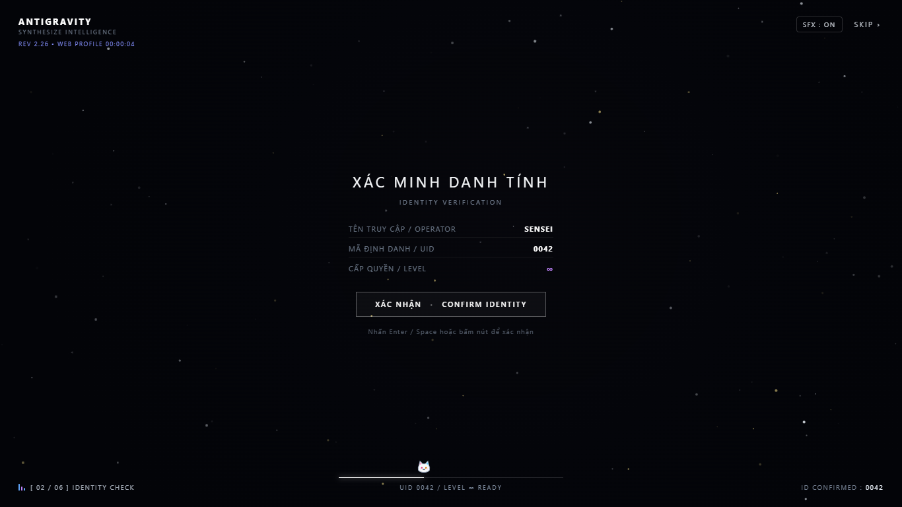
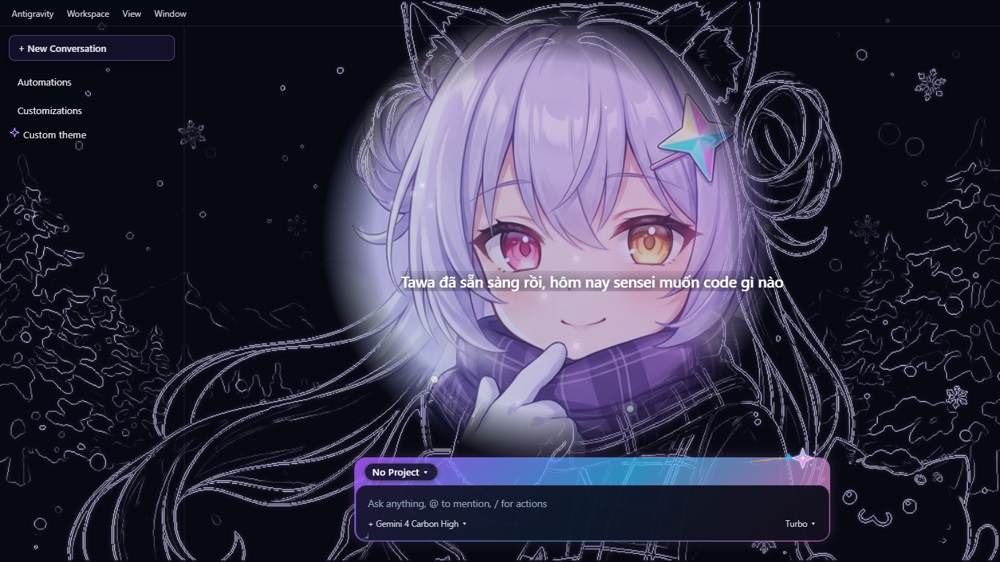
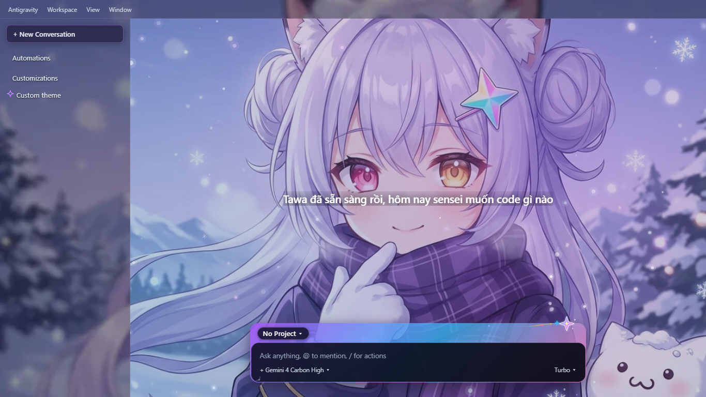
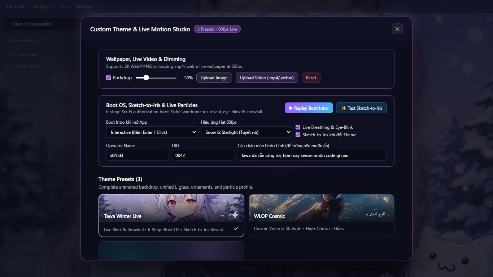

# Antigravity Live Theme — Tawa Winter OS (60fps Animated Theme & Skill)

Bộ giao diện động **60fps Zero-Lag** cho **Google Antigravity IDE / Manager** (kèm chuẩn **AI Agent Skill `SKILL.md`**):
- **6-Stage Sci-Fi Tactical Boot OS:** Màn hình khởi động xác thực 6 bước (`Authorization` → `Identity Check` → `Permission Stream` → `Orbital Verify` → `Welcome`) + âm báo tinh thể WebAudio + mèo tuyết nhảy trên thanh tiến trình + nút `SKIP ›` (`Esc`).
- **1px Sobel Sketch-to-Iris Reveal:** Tự động tách nét vẽ phác thảo 1px thời gian thực từ bất kỳ ảnh/video nào rồi bung vòng tròn `mask-image` mượt mà mở ra không gian làm việc.
- **Live2D Eye-Blink + 60fps Snowfall & `.mp4`/`.webm` Video Loop:** Nhân vật chớp mắt tự nhiên (đơn & kép), hiệu ứng thở nhẹ GPU, tuyết rơi 3 lớp chiều sâu, hỗ trợ tải thẳng video nền `.mp4` / `.webm` (lưu trong `IndexedDB`, tự động về `0% GPU` khi thu nhỏ cửa sổ).
- **Zero Live Blur (Cuộn code mượt 120fps) & Split-Browser Safe:** Không dùng `backdrop-filter: blur()` gây tụt FPS trên Electron; tự động cắt lỗ trong suốt khi mở trình duyệt chia đôi màn hình.

---

## Ảnh chụp thực tế (Live Screenshots)

| 1. Xác minh danh tính (Boot Stage 2) | 2. Phác thảo viền 1px → Bung vòng tròn Iris |
| :---: | :---: |
|  |  |

| 3. Màn hình chính (Tuyết rơi 60fps + Chớp mắt Live2D) | 4. Bảng điều khiển Custom Theme & Motion Studio |
| :---: | :---: |
|  |  |

---

## Yêu cầu duy nhất (Prerequisites)

- **Windows 10 / 11** (hoặc macOS / Linux) đã cài **Antigravity**.
- **Node.js >= 22** (kiểm tra bằng `node -v`; nếu chưa có thì tải bản LTS tại https://nodejs.org — *không cần `npm install`, không cần Python vì gói đã build sẵn `dist/theme_payload.js`*).

---

## Cách cài đặt 1 chạm cho Windows (Khuyên dùng)

### Cách A — Tải ZIP hoặc Clone rồi bấm đúp 1 file duy nhất
1. Tải repo về bằng Git (hoặc bấm **Code → Download ZIP** rồi giải nén):
   ```powershell
   git clone https://github.com/DaoHuuTrong2404/antigravity-live-theme.git
   cd antigravity-live-theme
   ```
2. Bấm đúp trực tiếp vào file **`CAI-DAT-1-CHAM.bat`** (hoặc chạy lệnh bên dưới trong PowerShell):
   ```powershell
   powershell -ExecutionPolicy Bypass -File .\scripts\install-win.ps1 -Relaunch
   ```
   **Script sẽ tự động làm hết 100%:**
   - Chép bộ theme & skill vào `~/.gemini/config/skills/antigravity-custom-theme` (xóa thư mục tải về cũng không mất theme).
   - Tự động gắn cờ mở cổng CDP (`--remote-debugging-port=0 --remote-allow-origins=*`) vào các shortcut Antigravity (Desktop, Start Menu, Taskbar).
   - Đăng ký daemon chạy ngầm nhẹ cùng Windows Startup.
   - Tự tắt tiến trình Antigravity chạy ngầm dưới khay hệ thống (System Tray) và mở lại Antigravity kèm màn hình **Boot OS 6 bước → Tawa Winter Live** ngay lập tức!

### Cách B — Cài trên macOS / Linux
```bash
git clone https://github.com/DaoHuuTrong2404/antigravity-live-theme.git ~/.gemini/config/skills/antigravity-custom-theme
cd ~/.gemini/config/skills/antigravity-custom-theme
bash scripts/install-unix.sh
# Mở lại Antigravity kèm cờ: --remote-debugging-port=0 --remote-allow-origins=*
```

---

## Tùy chỉnh trực tiếp trong Antigravity

Sau khi cài xong, nhìn thanh bên trái của Antigravity (ngay dưới mục `Customizations`) sẽ có nút **`✨ Custom theme`**:
- Đổi **Operator Name** (`SENSEI`), **UID** (`0042`), và **Câu chào giữa màn hình chính**.
- Bấm **`Upload Video (.mp4/.webm)`** hoặc **`Upload Image`** để thay bất kỳ hình nền động Wallpaper Engine / TikTok nào của riêng bạn.
- Chuyển chế độ Boot Intro: `Interactive (Bấm Enter / Click)` | `Auto-Play (Tự lướt nhanh)` | `Off (Tắt)`, hoặc bấm **`▶ Replay Boot Intro`** / **`✨ Test Sketch-to-Iris`** để xem lại hiệu ứng bất cứ lúc nào.
- Đi kèm sẵn **3 Presets**: `Tawa Winter Live`, `WLOP Cosmic`, và `Midnight Obsidian`.

---

## Gỡ cài đặt sạch sẽ 1 chạm (Uninstall)

Bấm đúp vào **`GO-CAI-DAT.bat`** (hoặc chạy `node scripts/uninstall.js`): tự động dừng daemon nền, xóa shortcut khởi động cùng Windows và trả giao diện Antigravity về mặc định ngay lập tức mà không đụng tới bất kỳ file hệ thống nào của Antigravity.

## License

MIT
